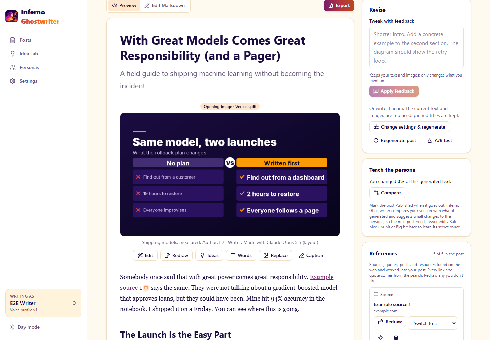
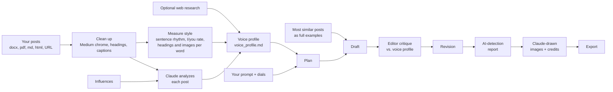
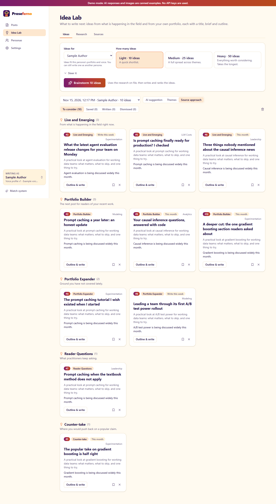
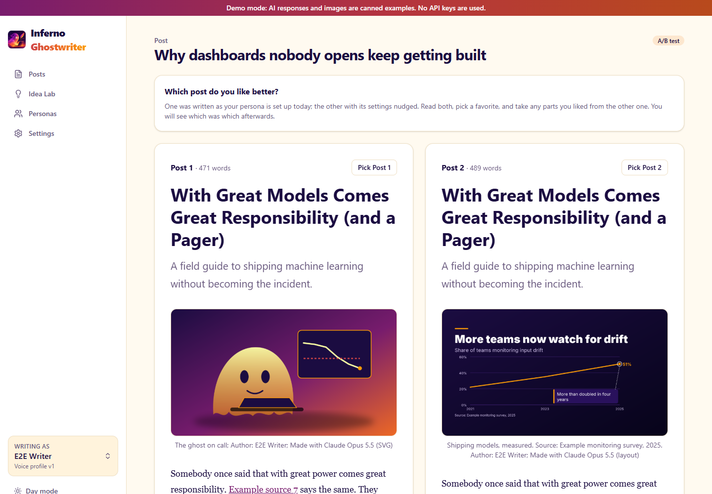
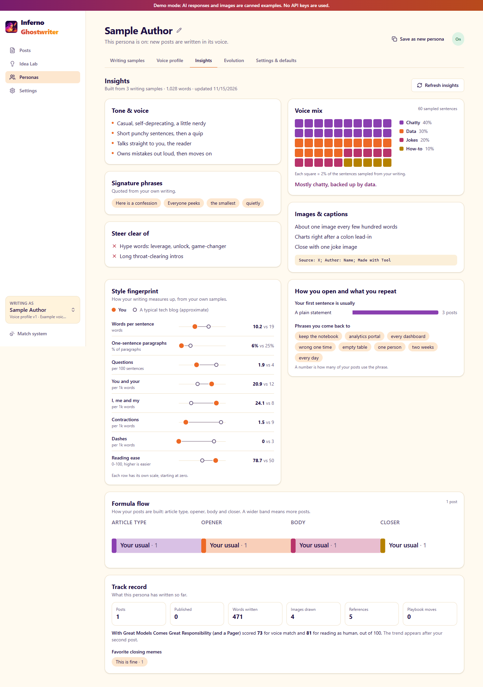
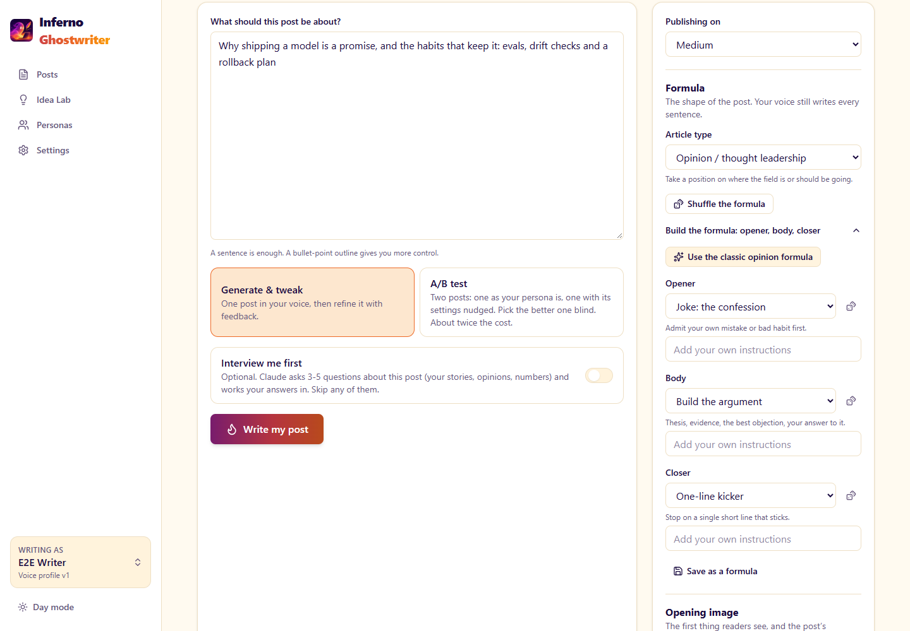
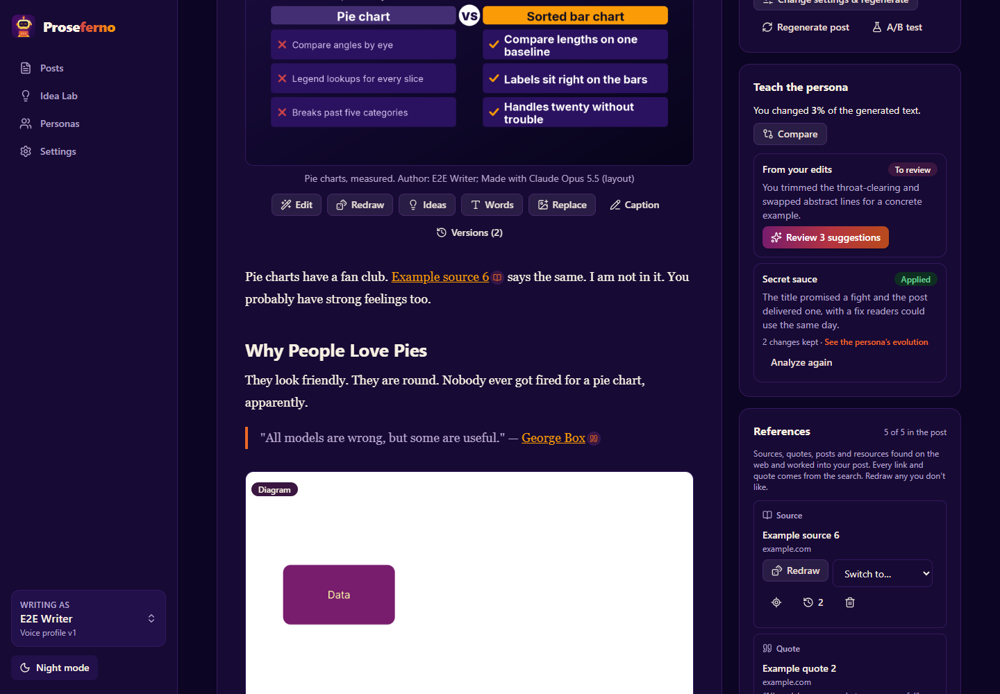

<p align="center">
  
</p>

<p align="center">
  <strong>The AI ghostwriter for technical minds.</strong><br>
  Inferno Ghostwriter learns how <em>you</em> write from your past posts (or builds a voice with you if you have none yet), finds what is worth writing next, then drafts, illustrates, tests and exports posts your readers would swear you wrote yourself.
</p>

<p align="center">
  <a href="../../actions/workflows/ci.yml"></a>
  
  
  
</p>

<p align="center">
  <a href="docs/getting-started.md"><strong>Get started in 10 minutes (no tech skills needed)</strong></a> ·
  <a href="#why-not-just-use-an-ai-chat">Why this, not a chat?</a> ·
  <a href="docs/onboarding.md">Contribute</a>
</p>

---



> **Just curious?** Run `launch.bat --demo` (Windows) or `./launch.sh --demo` (macOS/Linux). It opens on a finished example post with no account, no API key and no cost. **Never opened a terminal?** Follow the [step-by-step guide with screenshots](docs/getting-started.md).

## Why not just use an AI chat?

A chat window gives you a draft in *its* voice, once, with no memory, no pictures you can use and no idea whether anyone will read it. Inferno Ghostwriter is a whole writing studio built around one promise: **the post must sound like you, and it must be ready to publish.**

| | A general AI chat or a generic AI ghostwriter | Inferno Ghostwriter |
| --- | --- | --- |
| **Voice** | A style prompt you retype every time; drifts toward the same polished, generic tone | Measures your real writing (sentence rhythm, openers, humor, structure), writes a versioned **voice profile**, and an editor checks every draft against it |
| **What to write** | You bring the idea | **Idea Lab** researches public feeds and the web, reads your own gaps, and ranks 10, 25 or 50 ideas with sources |
| **Quality control** | One shot, you review it | A **writers' room**: a plan, a draft, an editor's critique, a revision; an independent judge panel picks your opening image; a meme room pitches and scores the closer |
| **Is it better?** | You guess | **A/B Test Mode** writes two versions, you read them blind, pick a winner, and the winning changes are adopted into your persona |
| **Images** | Text only, or stock art | Opening image, diagrams, data charts, mock screenshots and a closing meme, all drawn for *this* post, credited, editable and redrawable |
| **Facts and links** | Plausible-sounding, sometimes invented | Every source, quote and link is checked against a real web search, or left out |
| **Sounds human?** | Unknown | A **reads-as-human score** (0-100) calibrated to your own writing, with one-click Humanize |
| **Where it goes** | Copy, paste, reformat | One-click optimized export for **Medium, Substack, LinkedIn** (article, feed post, PDF/PowerPoint carousel), **X Articles** and **Gumroad** |
| **Getting better** | Starts from zero every chat | Learns from every edit you make, and from which posts you publish and how they perform |
| **Your data** | In someone else's history | Stays on your computer; keys live in your operating system's keychain |

**When a plain chat is enough:** a one-off email, a quick summary, anything where nobody needs to recognize your voice. Reach for Inferno Ghostwriter when you publish under your name and want it to keep sounding like you.

## How it works

Every step is in the banner: **Research, Outline, Write, Optimize, Publish.**

1. **Research.** [Idea Lab](docs/idea-lab.md) reads free public feeds and sends web-search scouts to find launches, claims, creator waves and industry patterns, then ranks ideas against what you have already written. Optional web research also gathers current best practice for titles, storytelling and skimmable structure.
2. **Outline.** Pick a **persona** (you can keep several: a deep-dive voice, a playful LinkedIn voice, and so on; one is on at a time) and a [formula](docs/formulas.md) (11 article types, 16 openers, 18 bodies, 12 closers), or leave both on automatic. Type a sentence or a bullet outline.
3. **Write.** A plan, a streamed draft in your voice, an editor's critique against your voice profile and your closest example posts, and a revision. References, images and an AI-detection report follow.
4. **Optimize.** Tweak with feedback, rewrite or expand a highlighted section, redraw any image, and [A/B test](docs/ab-testing.md) a challenger version. Platform exports are shaped for where the post is going.
5. **Publish.** Export for the platform you picked. Mark the post Published and rate how it did: Inferno Ghostwriter [learns](docs/evolution.md) what your edits and your hits have in common.

It is specialized for technical writing: data science, Python, data visualization, machine learning, causal inference and experimentation, analytics leadership, AI/LLMs/agents, ML platforms and building with agentic coding tools. It suits developers, data scientists, analysts, engineers, technical marketers, researchers and subject-matter experts.

## Features

- **Learns your voice.** Upload your posts (Word, PDF, Markdown, HTML, or a URL; Medium exports are cleaned up automatically). Add writers you admire as *influences*: Inferno Ghostwriter borrows their techniques, never their identity.
- **Voice profile.** A versioned `voice_profile.md` per persona: your soul, tone, signature moves, structure, title formulas, humor, teaching style, credibility habits, caption format, lexicon, and verbatim voice anchors, grounded in measured statistics from your writing. Regenerate or edit it any time.
- **Optional web research** on current best practices for titles, storytelling, skimmable structure, humor, insight, credibility and teaching.
- **Personas.** Create several (different names, different voices); exactly one is on at a time. Switch personas and pin any earlier voice profile version from the sidebar, name versions, rename personas, or branch a version into a new, separately named persona.
- **Idea Lab: know what to write next.** Live research reads free public feeds (vendor blogs, papers, new repositories, Hacker News, Stack Exchange, publications and newsletters, industry news) and sends out Claude web search scouts for launches, what notable practitioners are claiming, what other writers are all publishing, and what each industry is building. Brainstorm 10, 25 or 50 ideas from that research and from your own portfolio (what to build on, where to branch out), each with a title, brief, outline and the links it came from. Order them by AI suggestion, theme or source, keep sending searches to dig deeper, then write any idea, or A/B test it, in one click.
- **One prompt per post.** Type a sentence or a bullet outline. Everything else has smart defaults from the persona: length, image count, humor, education level, storytelling, opinion strength, formality, technical depth, skimmability, code, topic, audience, platform. Open *Customize* to change any of them for one post.
- **Formulas.** Choose the shape of each post, or build your own: 11 article types (deep narrative, top N countdown, how-to, tutorial, X vs. Y, explainer, case study, hands-on, lessons learned, opinion, tool review), 16 openers (five kinds of joke, story, bold and serious ones), 18 body structures and 12 closers, plus your own instructions for any part. You do not have to pick: the article type is read from your brief, and *Shuffle the formula* draws a fresh opener, body and closer that suit it. Save combinations under a name and set one as a persona's default. Anything left automatic is written the way you usually write it, and the closing meme always follows.
- **Voice-fidelity loop.** Plan → streamed draft → an editor critiques the draft against your voice profile and example posts → revision. You see a measured style score and the editor's scores. Edit the title, pin the options you like, and ask Claude for new ones.
- **Ways to revise.** *Tweak with feedback*: type what to change and Claude makes surgical edits, keeping the rest of your text and images (and redrawing only an image you mention). *Edit brief & settings*: see the brief or outline the post was written from, borrow the outline Claude planned, change any dial, the platform or the persona, and regenerate. Or *Regenerate post* as is. Highlight any section to *rewrite, compact, expand, add a source or quote*, or give it a brief. *Undo* any tweak, rewrite or edit from the last ten versions.
- **A/B Test Mode.** Write a post twice: once as your persona is, once with its settings, formula, voice emphasis, writing principles, example posts, title angle and image style nudged at random (same length). Read both side by side without knowing which is which, pick a winner, take the parts you liked from the other one (title, opener, closer, hero, meme, image style, or a note), and only then see which was the tweaked one. If it won, adopt its changes into your persona, all or some.
- **Backed by real references.** Every post works in at least five verified references: sources for its claims, famous quotes from statistics, causality, AI/ML and tech, widely shared posts from AI/ML voices, tutorials, packages and videos, and related articles. They come from a web search after the draft is done, are woven into your sentences in your voice, and every link and quote is checked against what the search found. A small chip next to each one lets you **Redraw** it, switch it to another kind, or remove it.
- **Reads-as-human score, and humanizing.** Every post is scored from 0 (would be flagged as AI) to 100 (reads like you) against your own posts: a built-in light detector plus optional open-source AI-text detectors you can tick in any mix (all run on your computer), a blind twin test where Claude tries to tell passages from your real paragraphs, a tell scan and a texture check. A humanize round rewrites only what reads as machine-made, and one-click *Humanize* does it for any passage.
- **A copilot that fills the blanks like you.** The writer invents vivid anecdotes, examples and stories in your storytelling style, written next to your own real paragraphs; facts and sources stay real. Optionally, Claude interviews you first (3-5 questions) and works your answers in.
- **An opening image a panel picks.** The first picture is also the thumbnail, so Claude pitches several openings (a visual metaphor of the post's idea, beautiful data art, a cheat sheet, a sourced data chart, a big number, a versus split, a framework diagram, a screen mock, or an opening meme for a meme sandwich) and a panel of four judges (scroller, art director, fact checker, author) picks the most clickable one. Charts and big numbers print only researched, cited numbers; Claude looks at the finished image and sends it back once if it is not ready. Choose a style per post or per persona, or leave it on Auto.
- **Images that earn their place, drawn by Claude.** The opening image, concept icons, clarifying diagrams, data visualizations, mock screenshots of what the post describes, and a closing meme, all authored by Claude as SVG or Vega-Lite, rendered locally, placed inline and credited ("Author: You; Made with Claude Opus 5.5 (SVG)"). No other image service, nothing to set up. **Edit** any image by describing the change, **Redraw** it for a new take, **Replace** it with your own, or roll back through its versions. Give each post its own **brand kit** (style, palette, font, motif) and redraw every image in one click.
- **Gets better as you edit.** Inferno Ghostwriter remembers what you cut, swap and ask for in its drafts and writes so you don't have to fix it again. Posts plan their own callbacks, so key ideas and running jokes come back and pay off.
- **Evolves with every post you publish.** Mark posts Draft, Ready or Published and rate how they did (Too early, Small hit, Medium hit, Big hit). Publishing compares your final version with what Inferno Ghostwriter generated and proposes a few small changes to the persona; a hit is read for its secret sauce, which goes into the persona's playbook. Review and apply what you agree with (profile changes become a new voice profile version) and watch the share of text you need to edit fall.
- **Export** for Medium, Substack, LinkedIn (article, feed post and a PDF/PowerPoint document carousel), X (an X Article with a 5:2 header and a teaser post), Gumroad (PDF), or Markdown/Word, as a zip or copy-and-paste HTML with images embedded.
- **Day and night themes** in an inferno palette, a one-click Windows launcher, and a demo mode to try everything without API keys.

## Quick start

> **Never used a terminal, or want screenshots of every step?** Follow [Getting started: from zero to your first post](docs/getting-started.md).

**Windows:** double-click **`launch.bat`**. The first run installs what it needs (it asks before installing [uv](https://docs.astral.sh/uv/) or Node.js with winget), builds the app, and opens it in your browser.

**Windows, no developer tools:** build a standalone app and installer once with `packaging\build_windows.bat` (needs uv and Node.js on the build machine; [Inno Setup 6](https://jrsoftware.org/isinfo.php) for the installer). It produces `InfernoGhostwriter-Setup-<version>.exe`: a per-user install with Start menu and desktop shortcuts that needs no Python, Node or admin rights. Your data then lives in `%LOCALAPPDATA%\Inferno Ghostwriter`.

**macOS / Linux:**

```bash
./launch.sh
```

**Just looking, or no writing and no keys yet?** Start in demo mode. It opens on a finished example post with a voice profile, with canned AI responses and images, no keys, no cost, and a separate data folder. (If you launch with no Claude connection at all, the launcher offers this for you.)

```bash
launch.bat --demo
```

**Want to work on the code?** Run `scripts\setup.bat` (or `scripts/setup.sh`), then see [docs/onboarding.md](docs/onboarding.md).

Then follow the five-step setup guide in the app:

1. **Connect Claude**: *Sign in with Claude* (browser sign-in through the [Anthropic CLI](https://github.com/anthropics/anthropic-cli/releases), works with your organization's SSO) or paste an Anthropic API key. Have a Claude Pro or Max plan? Choose **Claude subscription** to run on it through [Claude Code](https://code.claude.com/docs/en/setup) instead ([details](docs/configuration.md#using-your-claude-subscription-pro-or-max)).
2. **Images**: nothing to do. Claude draws illustrations, icons, diagrams, charts and memes itself.
3. **Persona**: give it a name and a byline for image credits.
4. **Your voice**: either drop in three or more of your posts (upload, paste text or a URL; a `my_writing_examples/` folder in the repo is offered for one-click import and is git-ignored), or choose **I'm starting fresh** and pick a ready-made voice, name writers you admire, answer a few questions, or let it surprise you. No writing needed ([details](docs/no-writing-samples.md)).
5. **Voice profile**: generate it and read it. Edit anything that is off.

Then click **New post**, describe the post, and watch it being written. Not sure what to write? Open **Idea Lab** and brainstorm.

## Costs and accounts

| Service | Used for | Billing |
| --- | --- | --- |
| [Claude](https://platform.claude.com) (default model: Claude Opus 5.5) | Voice analysis, voice profile, planning, drafting, editing, AI-detection judge, every image | Your Claude Console (API) account by default. Or your Claude Pro/Max plan's usage limits, if you choose the **Claude subscription** connection (runs through your own Claude Code). |

You can switch to Claude Sonnet 5.5 (faster, cheaper) or Claude Fable 5.1 (most capable) in **Settings → Advanced**, and choose 0–2 editing passes.

## How Inferno Ghostwriter keeps your voice



Details: [docs/voice-pipeline.md](docs/voice-pipeline.md). To measure voice quality on your own writing, run the [voice-fidelity eval](docs/voice-pipeline.md#measuring-voice-fidelity): it holds out some of your real posts, regenerates them from a brief, and asks a blind judge to spot the real one. The [AI-detection eval](docs/ai-detection.md#eval) scores your real and generated posts for how human they read.

## Privacy

Everything stays on your computer in the `data/` folder: samples, voice profiles, posts, images, exports. API keys go into your operating system's keychain (Windows Credential Manager, macOS Keychain, Secret Service), never into files. Content is sent only to Claude, and only when you generate something. Images are drawn by Claude and rendered on your computer. Idea Lab also reads public feeds (plain requests with no key and nothing about you in them); you choose which in its Sources tab.

## Documentation

- [Getting started: step by step with screenshots](docs/getting-started.md)
- [Onboarding for contributors](docs/onboarding.md)
- [Architecture and repository layout](docs/architecture.md)
- [Voice pipeline and evaluation](docs/voice-pipeline.md)
- [Idea Lab: live research and ranked ideas](docs/idea-lab.md)
- [Images](docs/images.md)
- [Opening images: styles, the judging panel and facts](docs/opening-images.md)
- [The image kit: characters, famous memes, palettes and the judging panel](docs/image-kit.md)
- [Formulas: article types, openers, bodies and closers](docs/formulas.md)
- [References: sources, quotes, posts and resources](docs/references.md)
- [Persona evolution: stages, outcomes and the playbook](docs/evolution.md)
- [Persona insights: the voice digest and charts](docs/insights.md)
- [AI-generation detection](docs/ai-detection.md)
- [Exporting](docs/exporting.md)
- [Configuration](docs/configuration.md)
- [Contributing](CONTRIBUTING.md)
- [Security policy](.github/SECURITY.md) and [Code of Conduct](.github/CODE_OF_CONDUCT.md)

## A look around

| Idea Lab | A/B Test Mode |
| --- | --- |
|  |  |
| **Persona insights** | **Formulas** |
|  |  |

## Night mode



## License

[MIT](LICENSE) © Shelby Temple
