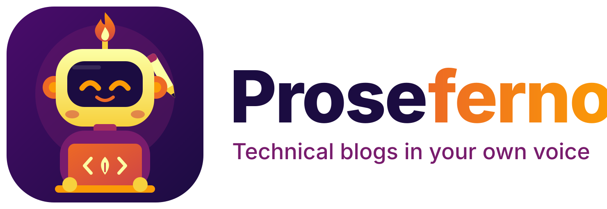
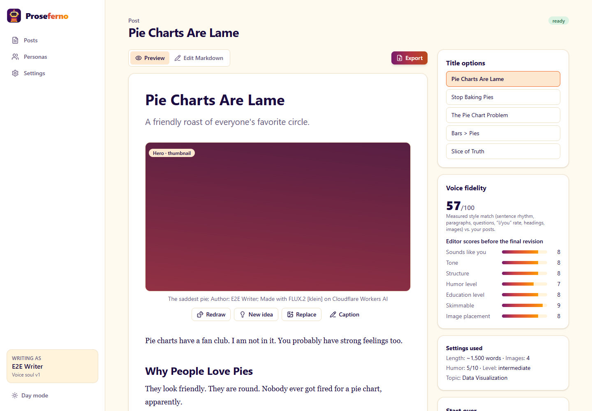
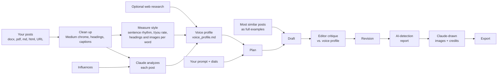
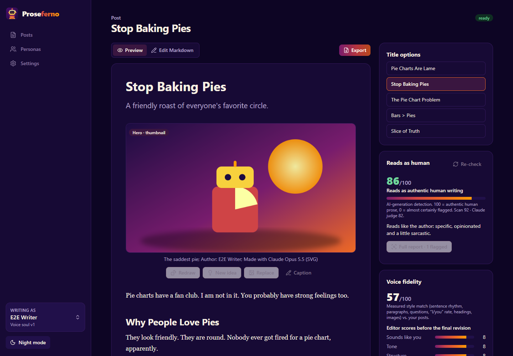

<p align="center">
  <picture>
    <source media="(prefers-color-scheme: dark)" srcset="assets/brand/logo-dark.svg">
    
  </picture>
</p>

<p align="center">
  <strong>Write engaging technical blog posts in your own voice.</strong><br>
  Proseferno learns how <em>you</em> write from your past posts, then drafts new ones (with diagrams, charts, a thumbnail and a closing meme) that your readers would swear you wrote yourself.
</p>

<p align="center">
  <a href="../../actions/workflows/ci.yml"></a>
  
  
  
</p>

---



> **New here?** Read [docs/onboarding.md](docs/onboarding.md). It covers using the app, exploring it with no files or API keys, and working on the code.

## Why Proseferno

Most AI writing tools produce the same polished, generic voice. Proseferno is built around one idea: **the post must sound like you.** It studies your writing, measures it, writes a field guide to your voice (your *voice profile*), and then has an editor check every draft against that guide before you see it.

It is specialized for technical writing about data science, Python, data visualization, machine learning, causal inference and experimentation, analytics leadership, analytics at large companies, AI/LLMs/agents, ML platforms (AWS, Snowflake), and building with agentic coding tools.

## Features

- **Learns your voice.** Upload your posts (Word, PDF, Markdown, HTML, or a URL; Medium exports are cleaned up automatically). Add writers you admire as *influences*: Proseferno borrows their techniques, never their identity.
- **Voice profile.** A versioned `voice_profile.md` per persona: your soul, tone, signature moves, structure, title formulas, humor, teaching style, credibility habits, caption format, lexicon, and verbatim voice anchors, grounded in measured statistics from your writing. Regenerate or edit it any time.
- **Optional web research** on current best practices for titles, storytelling, skimmable structure, humor, insight, credibility and teaching.
- **Personas.** Create several (different names, different voices); exactly one is on at a time. Switch personas and pin any earlier voice profile version from the sidebar, name versions, rename personas, or branch a version into a new, separately named persona.
- **One prompt per post.** Type a sentence or a bullet outline. Everything else has smart defaults from the persona: length, image count, humor, education level, storytelling, opinion strength, formality, technical depth, skimmability, code, topic, audience, platform. Open *Customize* to change any of them for one post.
- **Voice-fidelity loop.** Plan → streamed draft → an editor critiques the draft against your voice profile and example posts → revision. You see a measured style score and the editor's scores. Edit the title, pin the options you like, and ask Claude for new ones.
- **Three ways to revise.** *Tweak with feedback*: type what to change and Claude makes surgical edits, keeping the rest of your text and images (and redrawing only an image you mention). *Edit brief & settings*: see the brief or outline the post was written from, borrow the outline Claude planned, change any dial, the platform or the persona, and regenerate. Or *Regenerate post* as is. *Undo* any tweak, rewrite or edit from the last ten versions.
- **Reads-as-human score.** Every post gets an AI-generation detection report from 0 (would be flagged as AI) to 100 (authentic human prose): a scan calibrated to your own writing plus a Claude judge, with one-click *Humanize* for the passages a detector would catch.
- **Images that earn their place, drawn by Claude.** A hero illustration that doubles as the thumbnail, concept icons, clarifying diagrams, data visualizations, screenshot placeholders, and a closing meme, all authored by Claude as SVG or Vega-Lite, rendered locally, placed inline and credited ("Author: You; Made with Claude Opus 5.5 (SVG)"). No other image service, nothing to set up. **Edit** any image by describing the change, **Redraw** it for a new take, **Replace** it with your own, or roll back through its versions. Give each post its own **brand kit** (style, palette, font, motif) and redraw every image in one click.
- **Gets better as you edit.** Proseferno remembers what you cut, swap and ask for in its drafts and writes so you don't have to fix it again. Posts plan their own callbacks, so key ideas and running jokes come back and pay off.
- **Export** for Medium, Substack, LinkedIn (article, feed post and a PDF/PowerPoint document carousel), X (an X Article with a 5:2 header and a teaser post), Gumroad (PDF), or Markdown/Word, as a zip or copy-and-paste HTML with images embedded.
- **Day and night themes** in an inferno palette, a one-click Windows launcher, and a demo mode to try everything without API keys.

## Quick start

**Windows:** double-click **`launch.bat`**. The first run installs what it needs (it asks before installing [uv](https://docs.astral.sh/uv/) or Node.js with winget), builds the app, and opens it in your browser.

**Windows, no developer tools:** build a standalone app and installer once with `packaging\build_windows.bat` (needs uv and Node.js on the build machine; [Inno Setup 6](https://jrsoftware.org/isinfo.php) for the installer). It produces `Proseferno-Setup-<version>.exe`: a per-user install with Start menu and desktop shortcuts that needs no Python, Node or admin rights. Your data then lives in `%LOCALAPPDATA%\Proseferno`.

**macOS / Linux:**

```bash
./launch.sh
```

**Just looking, or no writing and no keys yet?** Start in demo mode. It opens on a finished example post with a voice profile, with canned AI responses and images, no keys, no cost, and a separate data folder. (If you launch with no Claude connection at all, the launcher offers this for you.)

```bash
launch.bat --demo
```

**Want to work on the code?** Run `scripts\setup.bat` (or `scripts/setup.sh`), then see [docs/onboarding.md](docs/onboarding.md).

Then follow the five-step setup guide in the app:

1. **Connect Claude**: *Sign in with Claude* (browser sign-in through the [Anthropic CLI](https://github.com/anthropics/anthropic-cli/releases), works with your organization's SSO) or paste an Anthropic API key. Have a Claude Pro or Max plan? Choose **Claude subscription** to run on it through [Claude Code](https://code.claude.com/docs/en/setup) instead ([details](docs/configuration.md#using-your-claude-subscription-pro-or-max)).
2. **Images**: nothing to do. Claude draws illustrations, icons, diagrams, charts and memes itself.
3. **Persona**: give it a name and a byline for image credits.
4. **Your writing**: drop in three or more of your posts. If you keep them in a `my_writing_examples/` folder in the repo, the app offers to import them in one click (that folder is git-ignored). No posts yet? Click **Use 3 sample posts** to try the whole flow first.
5. **Voice profile**: generate it and read it. Edit anything that is off.

Then click **New post**, describe the post, and watch it being written.

## Costs and accounts

| Service | Used for | Billing |
| --- | --- | --- |
| [Claude](https://platform.claude.com) (default model: Claude Opus 5.5) | Voice analysis, voice profile, planning, drafting, editing, AI-detection judge, every image | Your Claude Console (API) account by default. Or your Claude Pro/Max plan's usage limits, if you choose the **Claude subscription** connection (runs through your own Claude Code). |

You can switch to Claude Sonnet 5.5 (faster, cheaper) or Claude Fable 5.1 (most capable) in **Settings → Advanced**, and choose 0–2 editing passes.

## How Proseferno keeps your voice



Details: [docs/voice-pipeline.md](docs/voice-pipeline.md). To measure voice quality on your own writing, run the [voice-fidelity eval](docs/voice-pipeline.md#measuring-voice-fidelity): it holds out some of your real posts, regenerates them from a brief, and asks a blind judge to spot the real one. The [AI-detection eval](docs/ai-detection.md#eval) scores your real and generated posts for how human they read.

## Privacy

Everything stays on your computer in the `data/` folder: samples, voice profiles, posts, images, exports. API keys go into your operating system's keychain (Windows Credential Manager, macOS Keychain, Secret Service), never into files. Content is sent only to Claude, and only when you generate something. Images are drawn by Claude and rendered on your computer.

## Documentation

- [Onboarding: start here](docs/onboarding.md)
- [Architecture and repository layout](docs/architecture.md)
- [Voice pipeline and evaluation](docs/voice-pipeline.md)
- [Images](docs/images.md)
- [AI-generation detection](docs/ai-detection.md)
- [Exporting](docs/exporting.md)
- [Configuration](docs/configuration.md)
- [Contributing](CONTRIBUTING.md)
- [Security policy](.github/SECURITY.md) and [Code of Conduct](.github/CODE_OF_CONDUCT.md)

## Night mode



## License

[MIT](LICENSE) © Shelby Temple
