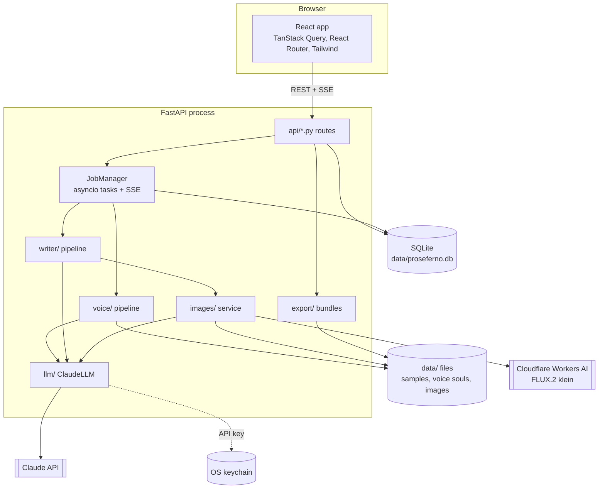

# Architecture

Proseferno is a single local process: a FastAPI backend that serves both the REST API and the built React app on `http://127.0.0.1:8732`.

## Backend modules

| Module | Responsibility |
| --- | --- |
| `config.py` | Settings with smart defaults; `PROSEFERNO_*` env vars or `.env` override them. |
| `services.py` | Builds the long-lived services (engine, storage, secrets, auth, LLM, image provider, jobs). Tests and demo mode inject fakes here. |
| `db/` | SQLModel tables: `Persona`, `Sample`, `VoiceSoul`, `Project`, `ProjectImage`, `Job`, `AppSetting`. |
| `jobs.py` | Runs long work as asyncio tasks, persists status, and keeps an in-memory event log per job that `/api/jobs/{id}/events` streams as Server-Sent Events (with sequence ids, so reconnects resume cleanly). |
| `llm/` | The `LLM` protocol, the Claude implementation (adaptive thinking, per-task effort, structured outputs, streaming, refusal fallbacks, prompt caching) and credential resolution. |
| `ingest/` | Parsers, Medium clean-up and stylometrics. |
| `voice/` | Sample analysis, best-practice research, voice soul synthesis, exemplar selection. |
| `writer/` | Dials, plan → draft → critique → revise, passage rewrite. |
| `images/` | Image design (Claude), FLUX provider, SVG/Vega-Lite/meme/placeholder renderers, credits, redraw history. |
| `export/` | HTML/Markdown rendering and platform bundles. |
| `prompts/` | All prompts as Markdown templates. |
| `demo.py` | Fake Claude and fake image model used by tests and `--demo`. |

## Claude usage

| Task | Call | Effort (default) |
| --- | --- | --- |
| Analyze a sample | structured output (`SampleAnalysis`) | low |
| Best-practice research | streamed, `web_search` server tool | medium |
| Voice soul | streamed text | high |
| Plan a post | structured output (`ArticlePlan`) | medium |
| Draft / revise | streamed text | high |
| Critique | structured output (`Critique`) | medium |
| Design an image | structured output (`RasterSpec`, `SvgSpec`, `ChartSpec`, `MemeSpec`) | low |

All calls use `claude-opus-5-5` by default with adaptive thinking and the server-side refusal fallback (`fallbacks: "default"`), which retries a request on Anthropic's recommended model if a safety classifier declines it by mistake. The writer's system prompt is ordered *instructions → voice soul → example posts* with a cache breakpoint after the examples, so plan, draft, critique and revision calls in one job reuse the cached prefix.

## Frontend

- `src/api/`: fetch client, TanStack Query hooks, generated types, and `useJob` (SSE job stream with a pure reducer).
- `src/pages/`: Posts, New post, Post editor (`project/`), Personas, Persona detail, Settings, Welcome (setup guide).
- `src/components/`: app shell, UI primitives, article renderer, connection cards, sample uploader, voice soul panel.
- `src/theme/`: day/night/system theme with tokens defined in `src/index.css`.

In production the backend serves `frontend/dist`. In development (`dev.bat`) Vite proxies `/api` to the backend.
