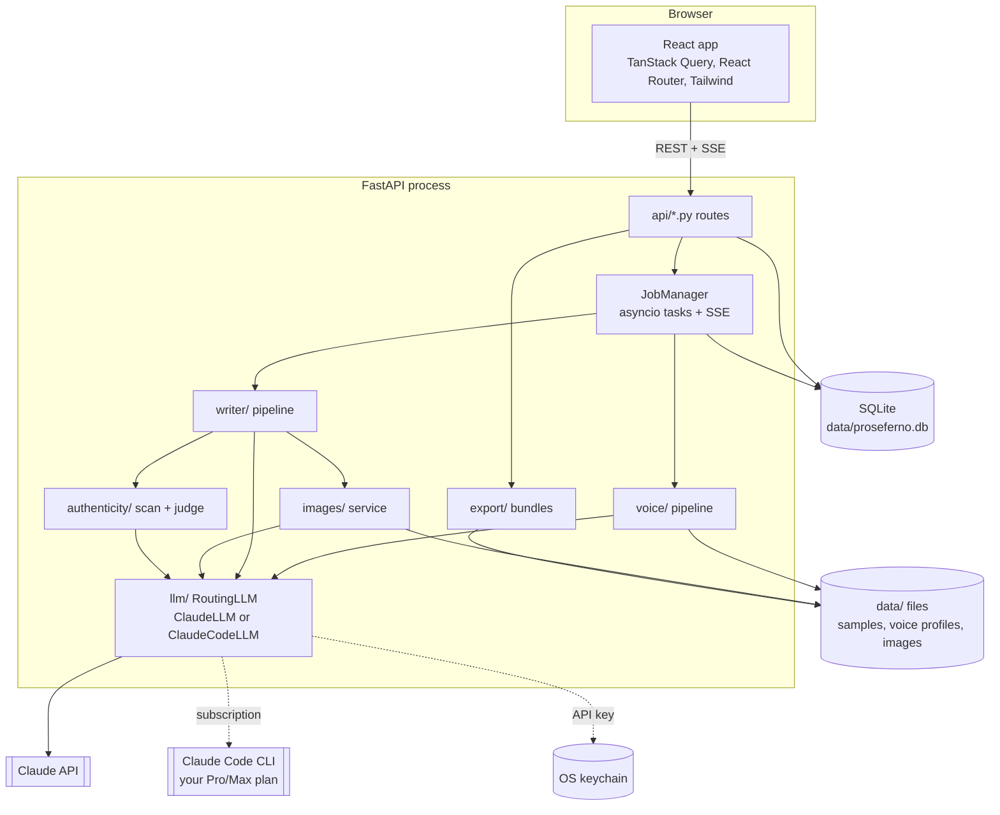

# Architecture

Proseferno is a single local process: a FastAPI backend that serves both the REST API and the built React app on `http://127.0.0.1:8732`.

## Backend modules

| Module | Responsibility |
| --- | --- |
| `config.py` | Settings with smart defaults; `PROSEFERNO_*` env vars or `.env` override them. |
| `services.py` | Builds the long-lived services (engine, storage, secrets, auth, LLM, image service, jobs). Tests and demo mode inject fakes here. |
| `db/` | SQLModel tables: `Persona`, `Sample`, `VoiceProfile`, `Project`, `ProjectImage`, `Job`, `AppSetting`. `make_engine` adds columns that newer versions define to older databases (additive only). |
| `jobs.py` | Runs long work as asyncio tasks, persists status, and keeps an in-memory event log per job that `/api/jobs/{id}/events` streams as Server-Sent Events (with sequence ids, so reconnects resume cleanly). |
| `llm/` | The `LLM` protocol; `RoutingLLM`, which sends each call to the connection chosen in Settings; `ClaudeLLM` for the Anthropic API (adaptive thinking, per-task effort, structured outputs, streaming, refusal fallbacks, prompt caching, retries); `ClaudeCodeLLM` for a Claude subscription, which runs the user's own `claude -p` with JSON output; and credential resolution. |
| `ingest/` | Parsers, Medium clean-up and stylometrics. |
| `voice/` | Sample analysis, best-practice research, voice profile synthesis, exemplar selection. |
| `writer/` | Dials (persona defaults + per-post overrides), plan → draft → critique → revise, passage rewrite, feedback tweaks (`tweak.py`), text version history (`revisions.py`), LinkedIn feed post. |
| `authenticity/` | AI-generation detection: a scan calibrated to the author's own samples plus a Claude judge, combined into a 0-100 "reads as human" score. |
| `images/` | Image design by Claude (SVG and Vega-Lite only), sanitizing renderers, placeholders, credits, redraw history. `images/memes/`: the meme format catalog, the two-call meme generator and the composer that owns meme layout and type. |
| `export/` | HTML/Markdown rendering and platform bundles, including the LinkedIn carousel (PDF + PPTX) and the X Article teaser post. |
| `prompts/` | All prompts as Markdown templates. |
| `demo.py` | Fake Claude used by tests and `--demo`. |

## Claude usage

| Task | Call | Effort (default) |
| --- | --- | --- |
| Analyze a sample | structured output (`SampleAnalysis`) | low |
| Best-practice research | streamed, `web_search` server tool | medium |
| Voice profile | streamed text | high |
| Plan a post | structured output (`ArticlePlan`) | medium |
| New title options | structured output (`TitleOptions`) | medium |
| Draft / revise | streamed text | high |
| Critique | structured output (`Critique`) | medium |
| Tweak with feedback | structured output (`PostEdits`) | medium |
| AI-detection judge | structured output (`AIDetectionJudgement`) | low |
| LinkedIn feed post | structured output (`LinkedInPost`) | medium |
| Design an image | structured output (`SvgSpec`, `ChartSpec`) | medium |
| Pitch closing memes | structured output (`MemeIdeas`) | high |
| Build a meme | structured output (`MemeBuild`) | medium |

Structured outputs are streamed too (`messages.stream(output_format=...)`): the SDK refuses non-streaming requests whose `max_tokens` could run past 10 minutes, and image designs ask for 24k tokens.

On the Claude subscription connection the same calls go through `claude -p` (`--json-schema` for structured outputs, `stream-json` for streamed text, the `WebSearch` tool for research); see [configuration](configuration.md#using-your-claude-subscription-pro-or-max).

All calls use `claude-opus-5-5` by default with adaptive thinking and the server-side refusal fallback (`fallbacks: "default"`), which retries a request on Anthropic's recommended model if a safety classifier declines it by mistake. The writer's system prompt is ordered *instructions → voice profile → example posts* with a cache breakpoint after the examples, so plan, draft, critique and revision calls in one job reuse the cached prefix. Feedback tweaks send the same prefix, so a tweak soon after generating (or another tweak) reads it from the cache, and they return only find/replace edits rather than the whole post, so output stays small.

## Frontend

- `src/api/`: fetch client, TanStack Query hooks, generated types, and `useJob` (SSE job stream with a pure reducer).
- `src/pages/`: Posts, New post, Post editor (`project/`), Personas, Persona detail, Settings, Welcome (setup guide).
- `src/components/`: app shell, UI primitives, article renderer, connection cards, sample uploader, voice profile panel.
- `src/theme/`: day/night/system theme with tokens defined in `src/index.css`.

In production the backend serves `frontend/dist`. In development (`dev.bat`) Vite proxies `/api` to the backend.
