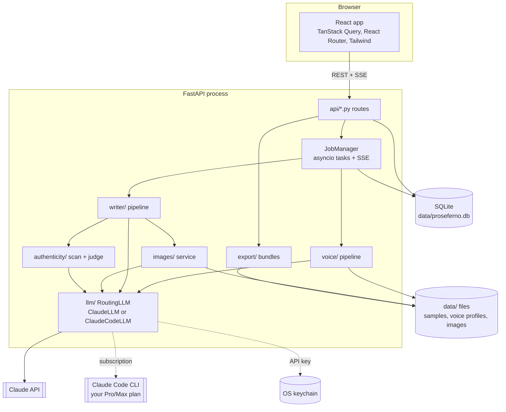

# Architecture

Proseferno is a single local process: a FastAPI backend that serves both the REST API and the built React app on `http://127.0.0.1:8732`.



## Backend modules

| Module | Responsibility |
| --- | --- |
| `config.py` | Settings with smart defaults; `PROSEFERNO_*` env vars or `.env` override them. |
| `services.py` | Builds the long-lived services (engine, storage, secrets, auth, LLM, image service, jobs). Tests and demo mode inject fakes here. |
| `db/` | SQLModel tables: `Persona`, `Sample`, `VoiceProfile`, `Project`, `ProjectImage`, `Job`, `AppSetting`. `make_engine` adds columns that newer versions define to older databases (additive only). |
| `jobs.py` | Runs long work as asyncio tasks, persists status, and keeps an in-memory event log per job that `/api/jobs/{id}/events` streams as Server-Sent Events (with sequence ids, so reconnects resume cleanly). |
| `llm/` | The `LLM` protocol; `RoutingLLM`, which sends each call to the connection chosen in Settings; `ClaudeLLM` for the Anthropic API (adaptive thinking, per-task effort, structured outputs, streaming, refusal fallbacks, prompt caching, retries); `ClaudeCodeLLM` for a Claude subscription, which runs the user's own `claude -p` with JSON output; and credential resolution. |
| `ingest/` | Parsers, Medium clean-up and stylometrics. |
| `voice/` | Sample analysis, best-practice research, voice profile synthesis, exemplar selection. |
| `writer/` | Dials (persona defaults + per-post overrides), plan → draft → critique → revise, passage rewrite, feedback tweaks (`tweak.py`), text version history (`revisions.py`), LinkedIn feed post. |
| `authenticity/` | AI-generation detection: a scan calibrated to the author's own samples plus a Claude judge, combined into a 0-100 "reads as human" score. |
| `images/` | Image design by Claude (SVG and Vega-Lite only), sanitizing renderers, placeholders, credits, redraw history. `images/memes/`: the meme format catalog, the two-call meme generator and the composer that owns meme layout and type. |
| `export/` | HTML/Markdown rendering and platform bundles, including the LinkedIn carousel (PDF + PPTX) and the X Article teaser post. |
| `prompts/` | All prompts as Markdown templates. |
| `demo.py` | Fake Claude used by tests and `--demo`. |
| `example.py`, `sample_content/` | The offline "Sample Author" example persona and the bundled sample posts that let a first run work with no files (see below). |
| `personas.py` | Persona helpers shared by the routes and the example seeding (add a sample, delete a persona). |
| `doctor.py` | `proseferno doctor`: machine checks with a fix for each problem, and the first-launch demo offer. |

## Repository layout

```
launch.bat / launch.sh             One-click start for people using the app
scripts/                           Developer scripts: setup, dev, check
backend/                           FastAPI + uv (Python 3.13)
  src/proseferno/
    api/        HTTP routes (auth, settings, personas, samples, voice, projects, images, export, jobs/SSE)
    ingest/     Parsers, Medium clean-up, stylometrics
    voice/      Sample analysis, research, voice profile synthesis, exemplar selection, learning from edits
    writer/     Dials, plan, draft, critique/revise, feedback tweaks, text history, LinkedIn feed post
    authenticity/  AI-generation detection: calibrated scan + Claude judge
    images/     Claude image design, SVG/Vega-Lite renderers, memes, credits
    export/     Medium, Substack, LinkedIn (carousel PDF/PPTX), X Article, Gumroad (PDF), Markdown/Word bundles
    llm/        Claude client, sign-in resolution
    prompts/    Every prompt, as readable Markdown
    sample_content/  Bundled sample posts and the example voice profile
  tests/        pytest (fake Claude)
  evals/        Voice-fidelity and AI-detection evals (real API, opt-in)
frontend/                          React 19 + Vite + Tailwind CSS 4
  src/pages/    Posts, new post, editor, personas, settings, setup guide
  e2e/          Playwright tests (demo mode)
packaging/                         Windows app + installer build (PyInstaller, Inno Setup)
assets/brand/                      Logo and palette
docs/                              Guides (start with onboarding.md)
```

## Life of a post

What happens when someone clicks **Write my post**, in the order the code runs:

1. `frontend/src/pages/NewProjectPage.tsx` calls `useProjectMutations().create` (`frontend/src/api/hooks.ts`), which POSTs `/api/projects`.
2. `create_project` in `backend/src/proseferno/api/projects.py` checks there is an active persona with a voice profile, saves a `Project` row, and calls `start_generation`.
3. `start_generation` hands `writer.generate_article` to `JobManager.start` (`jobs.py`). The route returns the job id immediately (HTTP 201).
4. The browser navigates to `/projects/{id}?job={job_id}`. `useJob` (`frontend/src/api/useJob.ts`) opens `/api/jobs/{id}/events` (`api/jobs.py`) and folds the server-sent events into progress and the streaming draft.
5. In the job, `writer/pipeline.py` runs `write_post`: plan (`prompts/plan.md`), streamed draft (`draft.md`), critique (`critique.md`) and revision (`revise.md`), all through the `LLM` protocol, then the AI-detection report (`authenticity/`).
6. `_generate` then creates the image rows and `images/service.py` designs and renders each image (Claude writes SVG or Vega-Lite, resvg or vl-convert renders it), crediting the persona and the Claude model. A failed image gets its own `error` status and never fails the post.
7. The project becomes `ready`, the job finishes, and `ProjectPage.tsx` refetches the post and shows the editor.

Everything the pipeline needs from Claude goes through `llm/base.py`, which is why the tests and the demo can swap in `demo.FakeLLM`.

## The first run with no files

A new user may have no writing and no Claude connection, so three pieces make the empty app useful:

- **Sample posts** (`sample_content/*.md`): `POST /api/personas/{id}/samples/import-sample-writing` adds them as a persona's own writing, so the voice profile can be generated with nothing uploaded.
- **The example** (`example.py`): `seed_example` creates "Sample Author" with those samples, a voice profile and one finished post, by running the *real* voice and writing pipelines against `demo.FakeLLM` through the normal job manager. It cannot drift from how the app stores things, costs nothing, and `POST /api/example` / `DELETE /api/example` add and remove it. The persona has `is_example = true`, and the UI labels it.
- **Demo mode** seeds the example on its first start (`main._seed_demo`, turn off with `PROSEFERNO_DEMO_SEED=false`), and `main()` offers demo mode on a bare first launch from a terminal.

The first real persona becomes the active one even when the example is on (`api/personas.create_persona`).

## Claude usage

| Task | Call | Effort (default) |
| --- | --- | --- |
| Analyze a sample | structured output (`SampleAnalysis`) | low |
| Best-practice research | streamed, `web_search` server tool | medium |
| Voice profile | streamed text | high |
| Plan a post | structured output (`ArticlePlan`) | medium |
| New title options | structured output (`TitleOptions`) | medium |
| Draft / revise | streamed text | high |
| Critique | structured output (`Critique`) | medium |
| Tweak with feedback | structured output (`PostEdits`) | medium |
| AI-detection judge | structured output (`AIDetectionJudgement`) | low |
| LinkedIn feed post | structured output (`LinkedInPost`) | medium |
| Design an image | structured output (`SvgSpec`, `ChartSpec`) | medium |
| Pitch closing memes | structured output (`MemeIdeas`) | high |
| Build a meme | structured output (`MemeBuild`) | medium |

Structured outputs are streamed too (`messages.stream(output_format=...)`): the SDK refuses non-streaming requests whose `max_tokens` could run past 10 minutes, and image designs ask for 24k tokens.

On the Claude subscription connection the same calls go through `claude -p` (`--json-schema` for structured outputs, `stream-json` for streamed text, the `WebSearch` tool for research); see [configuration](configuration.md#using-your-claude-subscription-pro-or-max).

All calls use `claude-opus-5-5` by default with adaptive thinking and the server-side refusal fallback (`fallbacks: "default"`), which retries a request on Anthropic's recommended model if a safety classifier declines it by mistake. The writer's system prompt is ordered *instructions → voice profile → example posts* with a cache breakpoint after the examples, so plan, draft, critique and revision calls in one job reuse the cached prefix. Feedback tweaks send the same prefix, so a tweak soon after generating (or another tweak) reads it from the cache, and they return only find/replace edits rather than the whole post, so output stays small.

## Frontend

- `src/api/`: fetch client, TanStack Query hooks, generated types, and `useJob` (SSE job stream with a pure reducer).
- `src/pages/`: Posts, New post, Post editor (`project/`), Personas, Persona detail, Settings, Welcome (setup guide).
- `src/components/`: app shell, UI primitives, article renderer, connection cards, sample uploader, voice profile panel.
- `src/theme/`: day/night/system theme with tokens defined in `src/index.css`.

In production the backend serves `frontend/dist`. In development (`scripts\dev.bat`) Vite proxies `/api` to the backend.
