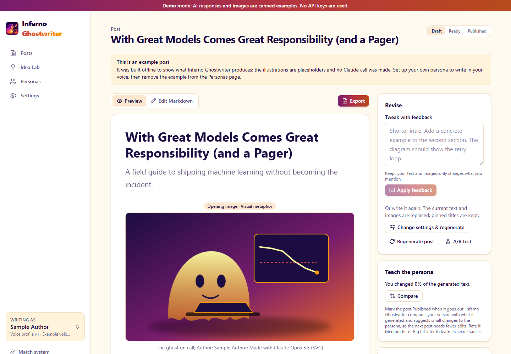
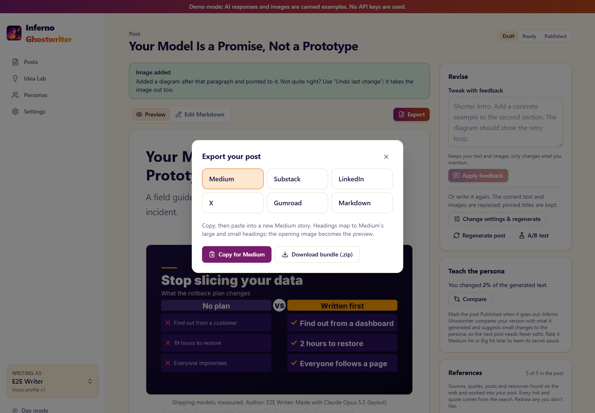
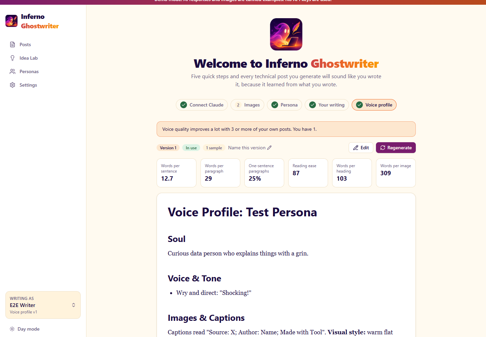
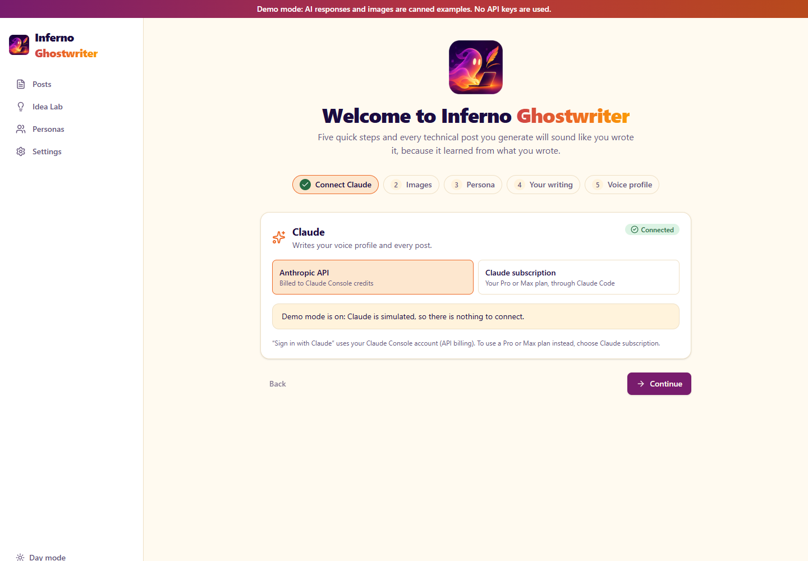
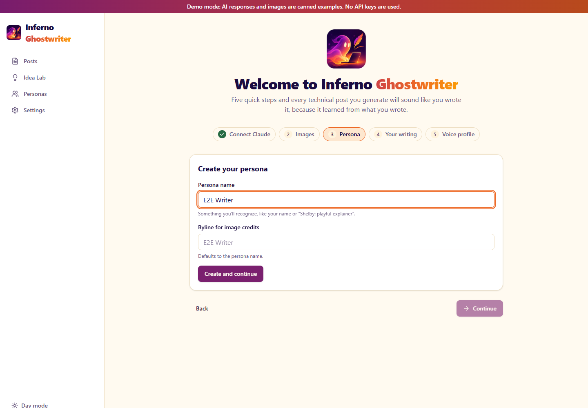
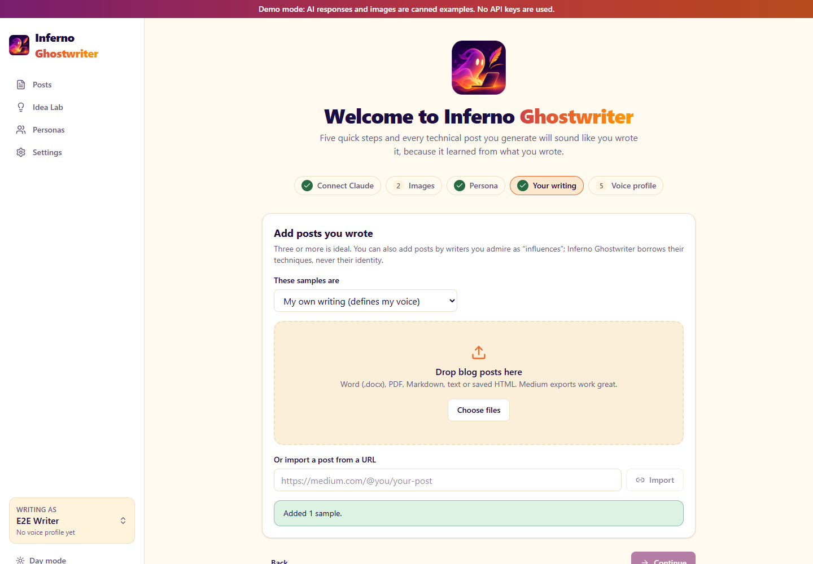
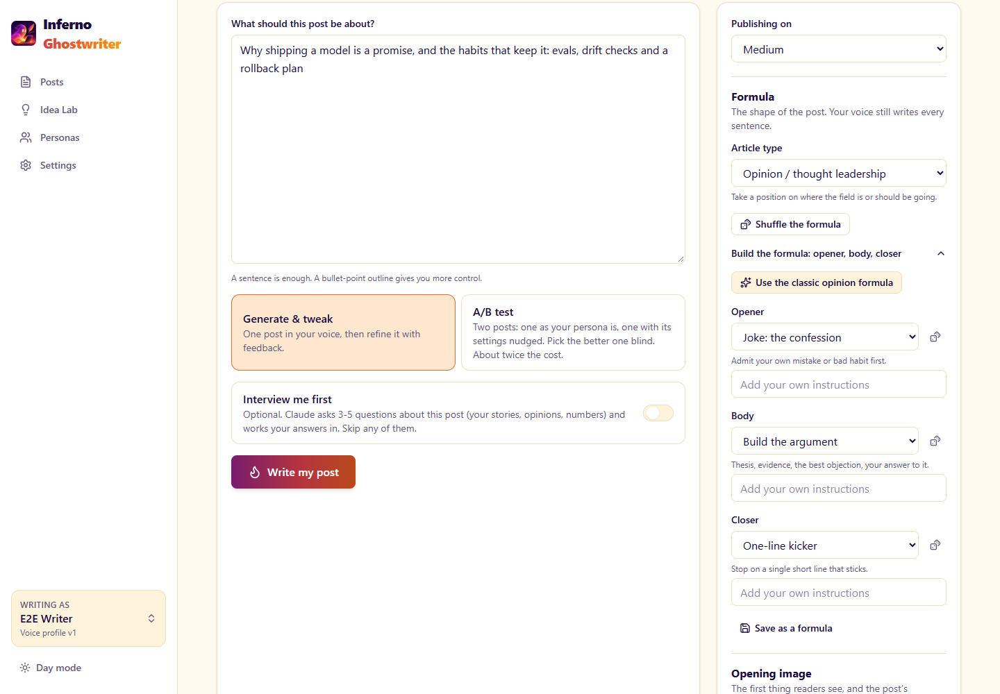
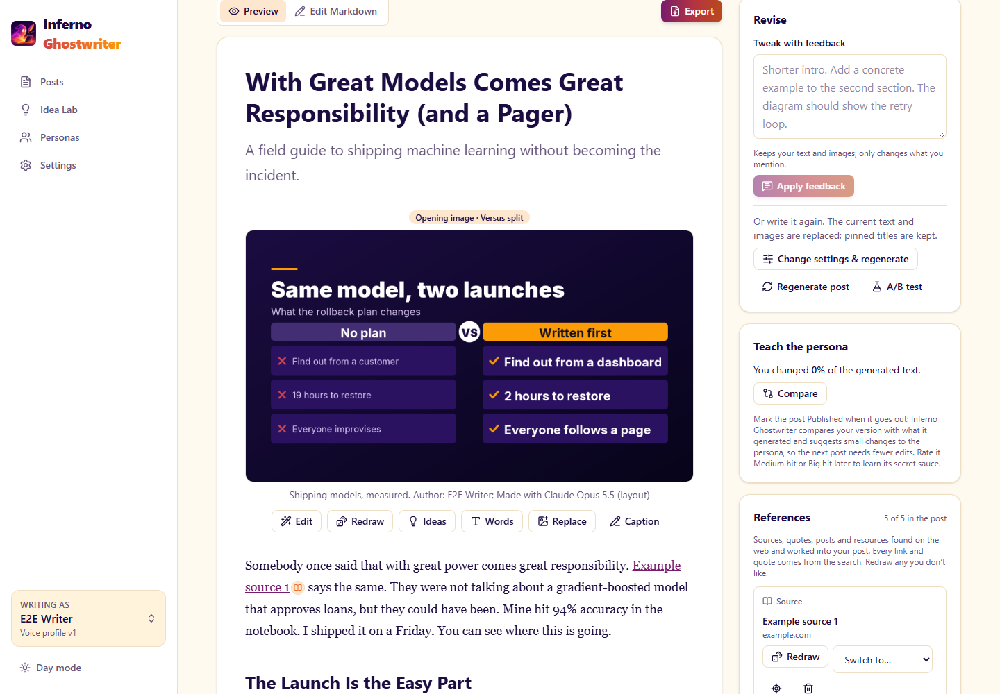
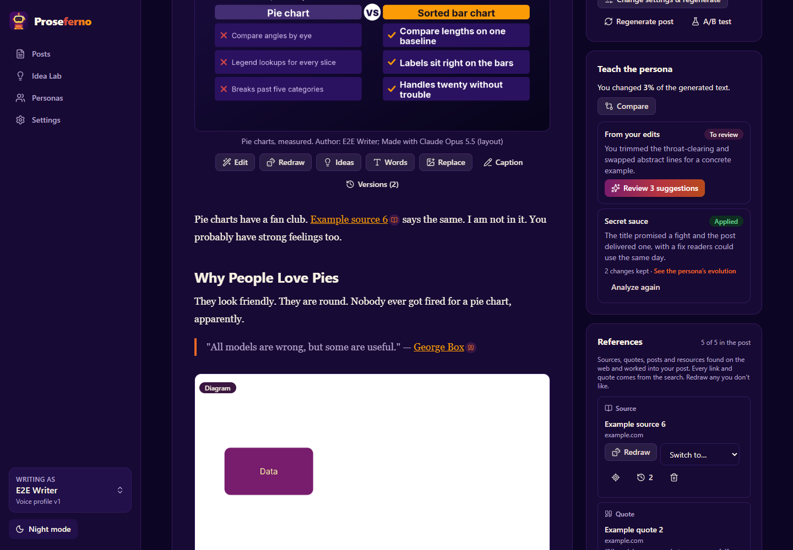

# Getting started: from zero to your first post

This guide assumes you have **never used a terminal** and have **no technical skills**. Nothing is skipped. If you get stuck, jump to [Troubleshooting](#troubleshooting).

You do not need to write any code. You will double-click one file, and everything else happens in your web browser.

**How long it takes:** about 10 minutes to see the app working in demo mode, and about 20 more to write your first real post.

## What you need

| You need | Why | Cost |
| --- | --- | --- |
| A Windows PC (macOS and Linux work too, see [below](#macos-and-linux)) | The app runs on your own computer | Free |
| A web browser (Chrome, Edge, Firefox, Safari) | The app opens in your browser | Free |
| An internet connection | The first launch downloads what it needs | Free |
| **For real posts only:** a Claude account | Claude does the writing and drawing | Pay as you go (API) or your existing Claude Pro/Max plan, see [Step 6](#step-6-connect-claude) |

> **Not sure yet?** Do Steps 1 to 5 first. They use **demo mode**: no account, no API key, no cost. You see exactly what the app produces before you decide anything.

## Step 1: Download the app

1. Open the project page on GitHub: <https://github.com/ThatShelbs/inferno-ghostwriter>
2. Click the green **Code** button near the top right.
3. Click **Download ZIP**.
4. Your browser saves a file called `inferno-ghostwriter-main.zip`, usually in your **Downloads** folder.

## Step 2: Unzip it

1. Open your **Downloads** folder.
2. Right-click `inferno-ghostwriter-main.zip` and choose **Extract All...**
3. Click **Extract**. A new folder opens.
4. Move that folder somewhere you will find it again, such as **Documents**. (Avoid very deeply nested folders; long paths can cause trouble on Windows.)

Inside the folder you will see a file named **`launch.bat`**. That is the only file you need to know about.

## Step 3: Start the app in demo mode

1. In the folder, hold **Shift**, right-click an empty space, and choose **Open in Terminal** (or **Open PowerShell window here**). If you do not see that option, skip to the next step instead.
2. Type this exactly and press **Enter**:

   ```bash
   launch.bat --demo
   ```

   (Or: double-click `launch.bat` to start the real app, and skip to Step 6 once it opens. The demo is just a safe first look.)
3. A black window opens and prints a few lines. This is normal: it is the app's engine. **Leave it open** while you use the app. Closing it stops the app.
4. **The first launch takes a few minutes.** If it asks to install **uv** or **Node.js** (free tools the app needs), type `y` and press **Enter**. Windows may ask you to approve the install; click **Yes**.
5. If Windows shows a blue **"Windows protected your PC"** screen, click **More info**, then **Run anyway**. This appears for any program that is not from a big publisher. The app's code is open for anyone to read in this repository.
6. When it is ready, your browser opens on its own to `http://127.0.0.1:8732`. That address only works on your own computer.

## Step 4: Look around the example

In demo mode the app opens with an example persona called **Sample Author** and one finished post, built with canned responses. A banner at the top says **Demo mode**, so you always know nothing real is being sent anywhere.



Try these, none of them can break anything:

- Click the post title, **With Great Models Comes Great Responsibility (and a Pager)**. Scroll through it: the opening image, a diagram, a chart, a code snippet and a closing meme are all part of the post.
- On the right, **Revise** lets you ask for changes in plain English ("shorter intro"), or regenerate the post.
- **Export** (top right of the post) shows the platforms the post can be prepared for.



## Step 5: See how a persona is set up

A **persona** is a writing voice. The app studies your posts and writes a **voice profile**: a plain-language guide to how you write. It then checks every draft against that guide.



Click **Personas** in the left menu, then **Sample Author** to read the example profile and its **Insights** tab. You can keep several personas (for example a serious one and a playful one) and switch between them. Only one is on at a time.

**Happy with what you saw?** Close the black window (or press **Ctrl+C** in it) to stop the demo. Then continue to set up the real thing.

## Step 6: Connect Claude

Start the real app by double-clicking **`launch.bat`** (no `--demo`). Your browser opens on a **Welcome to Inferno Ghostwriter** screen with a short setup guide.



Step 1 of the guide connects Claude. Pick whichever matches you:

| If you... | Choose | What happens |
| --- | --- | --- |
| Have a Claude Pro or Max plan | **Claude subscription** | Uses your plan's usage limits through Claude Code on your computer. |
| Have (or want) an Anthropic API account | **Paste an API key** | Create a key at <https://platform.claude.com>, paste it in, done. You pay Anthropic per use. The key is stored in your operating system's keychain, never in a file. |
| Use Claude through your company's single sign-on | **Sign in with Claude** | Opens a browser sign-in; works with organization SSO. |

A typical 1,500-word post uses a few dollars of API credit at most. In **Settings** you can switch to a faster, cheaper model.

## Step 7: Create your persona

1. Click **Persona** in the setup guide.
2. Type a **name** (your own name works), and a **byline**: the name shown in image credits, such as "Author: Alex Rivera".
3. Click **Create and continue**.



## Step 8: Teach it your voice

1. Gather **three or more** posts you have written. Word files, PDFs, Markdown, HTML, or links to the posts online all work. Medium exports are cleaned up automatically.
2. Drag them into the box, or click to choose files, or paste a link.
3. Wait for the confirmation, such as **Added 1 sample.**

   **No posts yet?** Choose **I'm starting fresh** instead and pick a ready-made voice, writers you admire, a short interview or a surprise. See [A voice without writing samples](no-writing-samples.md). You can add your own posts later.



4. Click **Generate my voice profile**. It takes a minute. When it finishes, read it. If something is off, edit it: it is plain text, and it is yours.

Optional: add writers you admire as **influences**. The app borrows their techniques, never their identity.

## Step 9: Write your first post

1. Click **Write my first post** (later: **New post** in the left menu).
2. Type one sentence, or a short bullet outline, about what the post should say. That is all you have to fill in.
3. Everything else has a smart default taken from your persona. To change anything for just this post, open **Customize**: length, number of images, humor, how much it teaches, the platform, the post's formula and more.
4. Not sure what to write? Click **Idea Lab** in the left menu. It researches what is happening in your field, compares it with what you have already written, and suggests ideas with sources. Click **Write this post** on any of them.



5. Click **Write my post** and watch it appear.

## Step 10: Polish and publish

When the post finishes you get an editor with the finished post, its images and a credit under each one.



- **Tweak with feedback.** Type what to change, in your own words. Only that changes.
- **Highlight any sentence.** A small toolbar appears: rewrite, compact, expand, add a source or a quote.
- **Images.** Each image can be **Edited** (describe the change), **Redrawn** for a new take, or **Replaced** with your own.
- **Reads-as-human score.** Shows how human the post reads, and one-click **Humanize** for the passages a detector would flag.
- **A/B test.** Write a second version and compare them without knowing which is which.
- **Undo.** The last ten versions are kept.

Finally, click **Export**, choose where the post is going (Medium, Substack, LinkedIn, X, Gumroad, Markdown or Word), and either download the bundle or copy the formatted text and paste it into the platform. Images come along, with credits.

## Day mode and night mode

Click the theme button at the bottom of the left menu to switch between **Day mode**, **Night mode** or **Match system**.



## Starting the app again later

Double-click **`launch.bat`** in the same folder. Your personas, posts and images are saved on your computer in the `data` folder next to it. Nothing is lost when you close the window.

## macOS and Linux

Open **Terminal**, go to the folder you unzipped, and run:

```bash
./launch.sh --demo
```

Drop `--demo` to run the real app. If macOS says the script cannot be opened, run `chmod +x launch.sh` once first.

## Troubleshooting

| Problem | What to do |
| --- | --- |
| The black window closes right away | Open a terminal in the folder (Step 3) and run `launch.bat` there so you can read the message, or run `uv run --project backend inferno-ghostwriter doctor`, which checks your computer and tells you how to fix what is missing. |
| "Windows protected your PC" | Click **More info**, then **Run anyway** (Step 3). |
| The browser opens on an error or does not open | Wait a minute and refresh, or open `http://127.0.0.1:8732` yourself. The black window must still be open. |
| "Port already in use" | Another copy is running. Close its black window, or restart your computer. |
| It says a path is too long | Move the folder closer to the drive root, such as `C:\InfernoGhostwriter`. |
| The post does not sound like me | Add more of your own posts (five or more is better), regenerate the voice profile, and edit anything off in it. Every edit you make also teaches the persona. |
| Setup is not what you expected | Run `uv run --project backend inferno-ghostwriter doctor` and send its output when you ask for help. |

## What next

- [Idea Lab](idea-lab.md): research and ranked ideas.
- [Formulas](formulas.md): choose the shape of a post.
- [A/B testing](ab-testing.md) and [persona evolution](evolution.md): get measurably better.
- [Exporting](exporting.md) and [configuration](configuration.md).
- Want to help build it? Start at [onboarding.md](onboarding.md).
