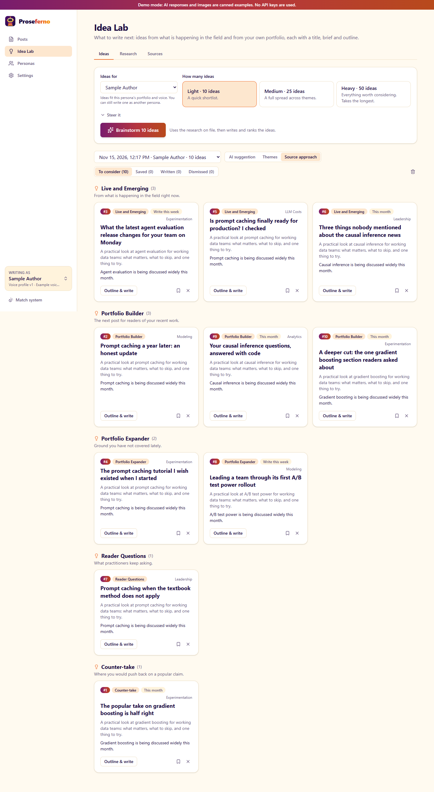

# Idea Lab

Idea Lab answers the question that comes before writing: **what should I write next?** It keeps a research base of what is happening in AI, machine learning, data science, analytics and BI, reads the persona's portfolio, and turns both into ranked ideas. Every idea has a title, a brief, an outline and the reason it is worth writing now, and one click sends it to the writer or to an A/B test.

Open it from **Idea Lab** in the sidebar (`/ideas`). It has three tabs: **Ideas**, **Research** and **Sources**.



## Using it

1. **Brainstorm.** Choose the persona the ideas are for and how many you want: Light (10), Medium (25) or Heavy (50). Under *Steer it* you can say what you want more of, paste your own half-ideas (*sparks*), switch the extra source approaches off, and choose whether to research first.
2. **Read the board.** Order it by **AI suggestion** (best first), **Themes** or **Source approach**; inside a group the best idea is always first. Save the ones you like, dismiss the ones you do not. Dismissed and written ideas are never proposed again.
3. **Open an idea** to see the outline, the links it came from, and five scores that explain its rank. Edit the title, brief or outline if you want.
4. **Write it.** Pick the persona to write as, then **Write this post**, **A/B test it**, or **Customize first** (opens *New post* with the brief filled in). The post records which idea it came from.

The first brainstorm runs the research, which takes a few minutes. After that the research is reused for a day unless you ask for a refresh.

## Source approaches

| Approach | What it proposes | Works from |
|---|---|---|
| **Live and Emerging** | Your take on a release, an industry pattern, or a subject many writers are covering | Trends in the research base |
| **Portfolio Builder** | The next post for readers of your recent work: sequels, deeper cuts, updates. Posts rated Good or Viral are followed first (tag `sequel`) | The portfolio |
| **Portfolio Expander** | Ground you have not covered lately: unused topics and article types | The portfolio's measured gaps |
| **Reader Questions** | The complete answer to something practitioners keep asking | `question` trends |
| **Counter-take** | Where you would push back on a claim that is spreading | `claim` trends |
| **Your Sparks** | Your own notes and links, developed into posts | The sparks you typed |

The first three are the core. Their share of each mode is fixed (`CORE_MIX` in `idealab/ideate.py`): Light 5/3/2, Medium 12/7/6, Heavy 24/13/13. Each extra approach that is on takes a tenth of the total (at least one idea) from the core, largest first. An approach with nothing to work from (no research yet, no posts, no claims found) hands its share to Live and Emerging, or to Portfolio Expander when there is no research either, and the board says so.

## The research base

Research happens in two layers, then a digest. Everything it finds is kept and added to, so the base grows with every refresh and every search.

1. **Collectors** (`idealab/collect.py`) read free feeds and open APIs with plain GET requests: no model call, no keys, a generic client name, nothing about you in the request. Only the title, link, date, a short summary and an engagement number are stored (`IdeaSignal`). A source that fails is reported in the Sources tab and never stops a refresh.
2. **Scouts** (`idealab/research.py`) are Claude web searches, three at a time, each given the collected items for its beat as leads:
   - launches and announcements (vendors, platforms, open source tools, plus the places with no feed);
   - what notable practitioners are saying (the watchlist, then anyone whose post is spreading);
   - what leading writers are publishing, looking for subjects several of them covered at once;
   - what practitioner communities are asking and arguing about;
   - one scout per industry, looking for the same project at several organisations.
3. **The digest** groups the scout findings and collected items into **trends** of five kinds: `launch`, `claim`, `industry_pattern`, `creator_wave` and `question`. Code then keeps only trends with at least one link that is a collected item or a page a scout cited (`checked_trends`). A trend nobody can link is dropped.

**Send another search** (Research tab) runs one more scout on anything you type, with a news feed for the same words, and merges what it finds into the base. Use it as often as you like before brainstorming.

A full refresh has three depths: quick, standard and deep (`idea_max_searches` searches per scout, times 0.5, 1 or 1.75). Items older than 45 days and trends not seen for 30 days are removed.

### Sources

The default catalog is `backend/src/proseferno/idealab/catalog.json`. It is the only place a source, person or industry is named: prompts receive names from the catalog or from what the research found.

| Group | Read directly | Covered by web search only |
|---|---|---|
| Vendors and platforms | Vendor and platform blogs with a feed | Vendors with no feed |
| Research | Curated daily papers and trending models; a preprint feed (off by default: high volume) | |
| Code | New repositories by stars, per topic | |
| Communities | Hacker News, Lobsters, two Stack Exchange sites | Reddit, LinkedIn, X, DEV |
| Creators and publications | Publication feeds, Medium tag feeds, newsletters | |
| Industries | A news search feed per industry | |

In the **Sources** tab you can switch any feed off, add your own RSS or Atom feed (most Substack and Medium publications have one), and edit the watchlist of people and the list of industries. *Reset to defaults* puts everything back.

Sites that refuse automated readers are not read directly and are not worked around: they are left to the web search scouts. Nothing needs a paid key, and nothing behind a login is scraped.

After editing the catalog, check it against the live sources:

```bash
cd backend
uv run python scripts/check_idea_sources.py --titles
```

## The portfolio

`idealab/portfolio.py` measures the portfolio in code, with no model call: the persona's posts in the app (with stage, outcome and date) and its own uploaded samples. Topic and article type are read the same way the writer reads them (`classify_topic`, `detect_article_type`). From that it works out the topic and type mix, the posts that did well, and the gaps: topics and article types missing from the last eight posts.

Samples have no publish date, so they count as older work; "recently" is exact only for posts made in the app.

## How ideas are written and ranked

`idealab/ideate.py`:

1. Each approach writes its ideas in batches of ten (`IdeaBatch`), about 30% more than its share. Every call gets the voice profile and playbook (who the author is), the portfolio, the material for that approach, what you asked for, the titles already proposed, and the ideas you saved, wrote or dismissed before.
2. Code checks each idea. An idea from a trend-based approach must name a real trend, and takes its links from that trend. `builds_on` must be the title of a real post. An unknown article type becomes `auto`.
3. Code removes duplicates: titles too close to another idea, to an existing post, or to an idea you already saw (`too_similar`). An approach left short gets one more batch.
4. One ranking call (`IdeaRanking`) scores every idea 1-10 on timeliness, reader demand, fit with the author, differentiation and ease, and assigns one of 6-10 themes. Code computes the overall score (weights 25/25/20/20/10) and keeps the best of each approach up to its share.

If research fails during a brainstorm, the ideas use what is already on file and a note says so. If the ranking call fails, ideas keep neutral scores and the order they were written in.

## What ideas may ask of the author

The idea prompt (`prompts/idea_system.md`) holds every idea to this:

- It must be writable from public sources and the author's own general experience. Nothing that depends on confidential details of an employer, client or colleague.
- Companies, products and people are named, because that is what makes a post useful. A factual claim about a named party must rest on a public source, and criticism is of the product, decision or argument, as the author's opinion with reasons.
- No disclaimers about whose opinions these are.

## From idea to post

`POST /api/ideas/{id}/write` builds a brief from the idea (`idea_brief`: title, brief, angle, outline, why now, and the source links), sets the post's article type, and creates the post through the same path as *New post*, as a standard generation or an A/B test. *Customize first* opens *New post* with that brief and passes `idea_id` when you submit. Either way the idea becomes **Written**, links to its post, and `Project.idea_id` records where the post came from. Deleting the post returns the idea to the saved list.

The persona's [Insights](insights.md) track record shows how many posts started from each source approach and how many of those did well.

## API

| Route | What it does |
|---|---|
| `GET /api/idea-lab` | Trends, item count, last refresh, search history, a research job in flight |
| `POST /api/idea-lab/research` | Job `idea_research`: full refresh, or one more search with `query` |
| `DELETE /api/idea-lab/trends/{id}` | Remove a trend |
| `GET` / `PUT /api/idea-lab/sources` | The source setup and each feed's health |
| `GET` / `POST /api/idea-lab/sessions` | List brainstorms; start one (job `idea_brainstorm`) |
| `GET` / `DELETE /api/idea-lab/sessions/{id}` | One brainstorm with its ideas; delete it |
| `GET` / `PATCH /api/ideas/{id}` | One idea; save, dismiss or edit it |
| `POST /api/ideas/{id}/write` | Start a post or an A/B test from it |

Only one Idea Lab job runs at a time. Neither job is reported as a persona's `active_job_id`, and a brainstorm interrupted by a restart is marked failed at startup.

## Settings

| Setting | Default | Meaning |
|---|---|---|
| `effort_idea_research` | `medium` | Scouts and the digest |
| `effort_idea_ideas` | `high` | Writing ideas |
| `effort_idea_rank` | `medium` | Scoring and theming |
| `idea_max_searches` | `8` | Web searches per scout at standard depth |
| `idea_window_days` | `14` | How far back feeds and scouts look |

## Cost

A full refresh at standard depth is up to nine scouts (four standing beats and up to five industries) of up to eight searches each, plus one digest call. A brainstorm is one call per ten ideas and one ranking call. Heavy mode with a fresh research run is the most expensive thing Idea Lab does; reusing research that is under a day old costs only the idea calls.

## Tests and demo mode

Tests and demo mode never go online: `NoSignalCollector` returns canned items and `demo.FakeLLM` returns canned scout findings, digests, ideas and rankings (`idealab/demo_data.py`). The canned content is invented and generic on purpose, so the demo never shows made-up news about a real company.

- `backend/tests/unit/test_idealab.py`: feed parsing, a failing source, the catalog and author changes, the link check, the mix, duplicate removal, selection.
- `backend/tests/api/test_idea_lab.py`: research, another search, 10/25/50 ideas, reuse of fresh research, sparks, dismissed ideas not returning, editing, writing a post or A/B test from an idea, sources, deleting.
- `frontend/src/lib/ideas.test.ts`, `frontend/src/pages/ideas/IdeaLabPage.test.tsx`, and a step in `frontend/e2e/tour.spec.ts`.
