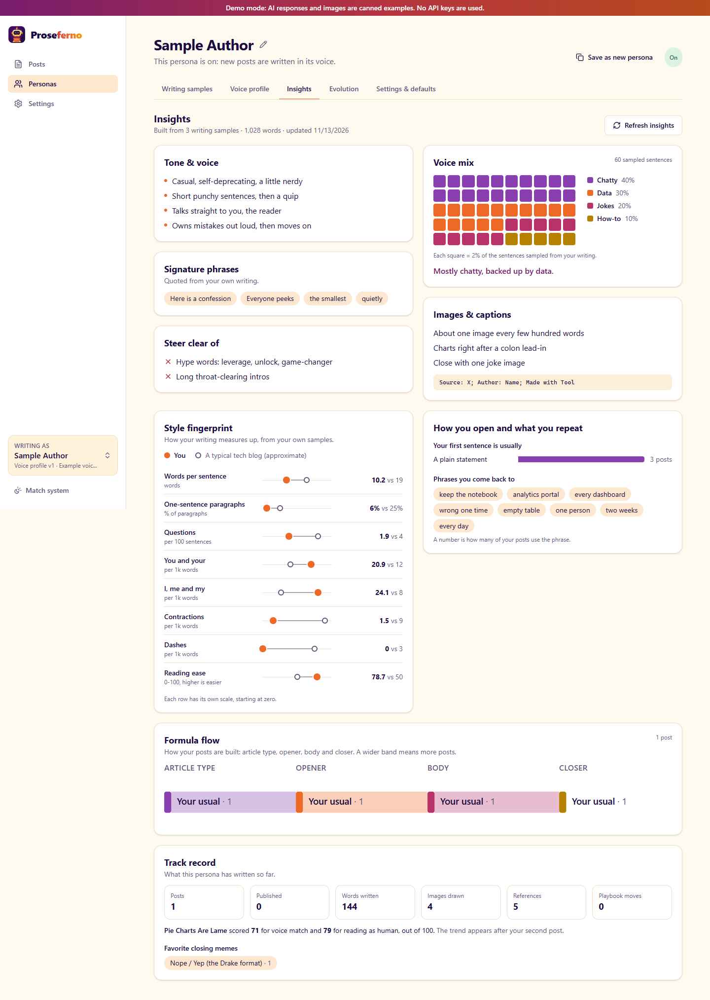

# Persona insights

Every persona has an **Insights** tab (Personas → a persona → Insights, or `/personas/{id}?tab=insights`). It answers "how do I write?" at a glance: a short digest of the voice profile, and charts measured from the samples and the posts.

## What is on the page

| Card | Where it comes from | Needs a voice profile |
|---|---|---|
| Tone & voice, Signature phrases, Steer clear of, Images & captions | The Claude digest | yes |
| Voice mix (waffle chart) | Claude labels sampled sentences, code counts them | yes |
| Style fingerprint | Stylometrics of your own samples against a reference | no |
| How you open and what you repeat | Stylometrics and sample analyses | no |
| Formula flow (Sankey) | The formula of every post with text | no |
| Track record | Posts, images, references, scores, edit lessons | no |

The measured cards work as soon as a persona has samples. A persona with no samples and no posts shows one empty state that links to the samples tab.

## The digest

`voice/insights.py` makes the digest with one structured call (`VoiceInsights`, prompt `prompts/voice_insights.md`, effort `effort_insights`, default `low`). It runs as the last step of voice profile generation and is saved on the version (`VoiceProfile.insights`). If the call fails, the profile is still saved and the digest is left empty.

Two things in the digest are checked by code, not trusted from the model:

- **Voice mix.** Code takes up to 60 prose sentences, spread evenly through your own samples (`sample_sentences`; headings, code, images, tables and captions are skipped). Claude names 3-5 kinds of sentence and labels each numbered sentence. Code counts the labels (`count_mix`) and ignores unknown categories, bad numbers and repeats. The percentages are therefore counts of real sentences. The waffle shows 50 squares, 2% each, split by largest remainder.
- **Signature phrases.** Only phrases that occur in your samples are kept (`verbatim_only`, ignoring case and punctuation).

Versions made by editing the profile by hand or by [persona evolution](evolution.md) have no digest of their own. The page then shows the newest digest, says which version it describes, and offers **Refresh insights**. Refresh runs the job `voice_insights` (`POST /api/personas/{id}/insights/refresh`) for the version in use. That job is not reported as the persona's `active_job_id`, so the Voice profile tab does not show it as a profile being generated.

## The measured charts

`GET /api/personas/{id}/insights` (`api/insights.py`) builds everything else on each request, with no model call.

- **Style fingerprint.** Eight measures from `ingest/stylometrics.py`, averaged over your own samples. The reference is the average of your influence samples ("Writers you read") when you have any. Otherwise it is `TYPICAL_TECH_BLOG`, a set of rough built-in values labeled as approximate. They are a point of comparison, not a target. Each row has its own scale.
- **Openers and phrases.** How each sample's first sentence opens (`opening_style`), and the recurring and signature phrases, each counted by how many of your posts use it. A phrase contained in a longer one is dropped.
- **Formula flow.** Each post's article type, opener, body and closer, resolved the same way as when the post was written (`writer.dials.resolve`). A part left automatic shows as "Your usual". A detected article type counts as that type. Band width is the number of posts.
- **Track record.** Totals, the voice match (`Project.fidelity`) and reads-as-human (`Project.authenticity`) scores per post, outcomes, the closing meme formats used most, and the edits you repeat most (`Persona.edit_lessons`). The trend chart appears from the second scored post.

## Charts in the frontend

There is no chart library. The charts are small React components in `frontend/src/pages/persona/insights/`, and the layout maths is in `frontend/src/lib/charts.ts` (`waffleCells`, `layoutSankey`), which is unit-tested.

Series colours are the theme tokens `--app-chart-1` to `--app-chart-5` in `src/index.css`, with separate values for day and night mode. Both sets were checked for colour-blind separation and contrast against the card surface. Use them in that order and do not add raw colours to components.

## Tests

- `backend/tests/api/test_insights.py`: empty persona, charts before a profile, the digest, the formula flow and track record, influences as reference, stale digest and refresh, a failed digest.
- `backend/tests/unit/test_insights.py`: sentence sampling, label counting, verbatim phrases.
- `frontend/src/lib/charts.test.ts` and `frontend/src/pages/persona/InsightsTab.test.tsx`.
- `frontend/e2e/tour.spec.ts`: opens the example persona's Insights tab in demo mode and refreshes the digest.
