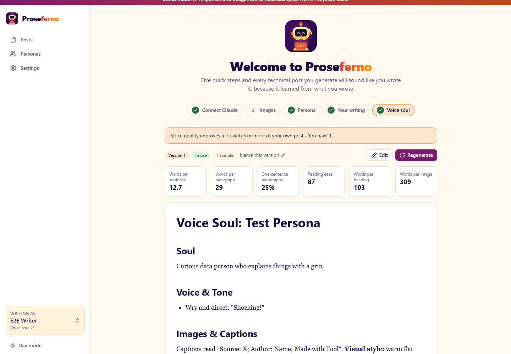

# Voice pipeline

Proseferno succeeds only if posts sound like their author. This page explains each step and how to measure the result.



## 1. Ingestion

`ingest/parsers.py` turns each sample into a sequence of blocks (headings, paragraphs, list items, code, quotes, images, captions).

Medium exports need special care (`ingest/cleanup.py`):

- UI chrome is removed: "Press enter or click to view image in full size", clap counts, *Follow*, *min read*, and similar lines.
- Title and subtitle are taken from the first lines.
- **Headings are recovered.** Exported posts have no heading styles, so short standalone lines that introduce body text are promoted to `##` headings. Questions that set up an image, and runs of short questions, are not.
- **Captions are detected**: a short line right after an image that looks like a credit (*Source:*, *Author:*, *Made with*, ...) is tagged as a caption. Caption wording is part of an author's style.

The cleaned post is stored as Markdown with `[IMAGE]` and `[CAPTION]` markers so the model sees where images sat.

## 2. Measurement

`ingest/stylometrics.py` computes deterministic numbers per post: sentence and paragraph length, share of one-sentence paragraphs, reading ease, question and exclamation rates, first-person and second-person rates, contractions, em dashes, parentheticals, words per heading, words per image, opening style, and recurring phrases. They are averaged into the persona's **baseline**.

These numbers ground the voice soul in fact and power the **style score** on every draft.

## 3. Analysis

Each sample gets a structured analysis (`voice/schemas.py: SampleAnalysis`): hook, title pattern, structure, voice traits with verbatim evidence, tone, rhythm, relationship with the reader, humor devices, storytelling, teaching and credibility moves, image and caption habits, closing, signature phrases, and the passages that sound most like the author. Analyses are cached on the sample, so regenerating a voice soul only analyzes new samples.

Influence samples are analyzed for **techniques to borrow**, never identity.

## 4. Research (optional)

When a persona has web research turned on, Claude searches for current guidance on titles, storytelling, skimmable structure, humor, insight, credibility and teaching, and writes a cited best-practices guide. It is reused for 30 days.

## 5. Voice soul

`prompts/voice_synthesize.md` turns the baseline, analyses and research into `voice_soul.md` with fixed sections: Soul · Voice & Tone · Signature Moves · Structure Blueprint · Titles & Subtitles · Humor · Teaching Style · Credibility & Trust · Images & Captions (including a one-line **visual style** for generated images) · Lexicon (including a *never use* list of generic AI-writing tells) · Do / Don't · Voice Anchors (verbatim passages).

Every version is kept. Editing it in the app saves a new version.

## 6. Writing a post

1. **Exemplars**: the two or three of the author's own posts most similar to the brief (TF-IDF) are included in full, within a word budget, never truncated.
2. **Plan**: five title options in the author's style, subtitle, hook, sections, closing, joke, and image slots (hero first, meme last).
3. **Draft**: streamed to the UI, with `{{image:slot}}` placeholders. Placeholders stand alone: the writer is told not to add caption or credit lines, and `strip_image_captions` removes any it adds anyway ("Photo by ... on Unsplash", "Visualization: ..."), because each image gets its own caption and credit.
4. **Critique**: an editor scores voice, tone, structure, humor match, education match, skimmability and image placement, with the measured style comparison, and lists concrete fixes.
5. **Revise**: the draft is rewritten to address the critique (0-2 passes; default 1).

After writing, the **Title** card lets the author edit the title text, pin options they like, and ask for **New options**: Claude replaces every option except the selected and pinned ones (`regenerate_titles`, `prompts/titles.md`). Pinned titles also survive *Regenerate post*.

## Measuring voice fidelity

`backend/evals/voice_fidelity.py` answers "can a careful reader tell?":

1. Hold out some of the author's real posts.
2. Extract the brief each one might have started from.
3. Generate a post from that brief **without** showing the writer the held-out post.
4. A blind judge sees excerpts of the real and generated posts (in both orders, to cancel position bias) and picks the author's.
5. Both posts get a style score against the baseline.

Judge accuracy near **50%** means the generated posts are indistinguishable; near 100% means they are easy to spot. Results are written to `data/evals/`.

It uses the real Claude API and costs roughly $1-2 per held-out post with Claude Opus 5.5:

```bash
cd backend
uv run python evals/voice_fidelity.py --persona "Your persona" --holdout 3 --yes
```

Check the wiring without API calls:

```bash
uv run python evals/voice_fidelity.py --demo --yes
```

The report also lists each post's scan score from the [AI-detection](ai-detection.md) check, so you can see whether generated posts read as human as the real ones.

Note: the voice soul's *Voice Anchors* may quote a held-out post. For the strictest test, regenerate the voice soul without the held-out posts first.
